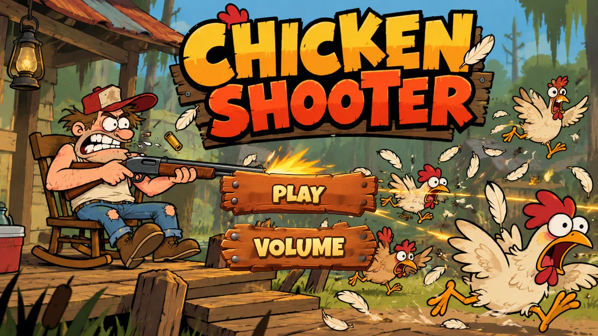
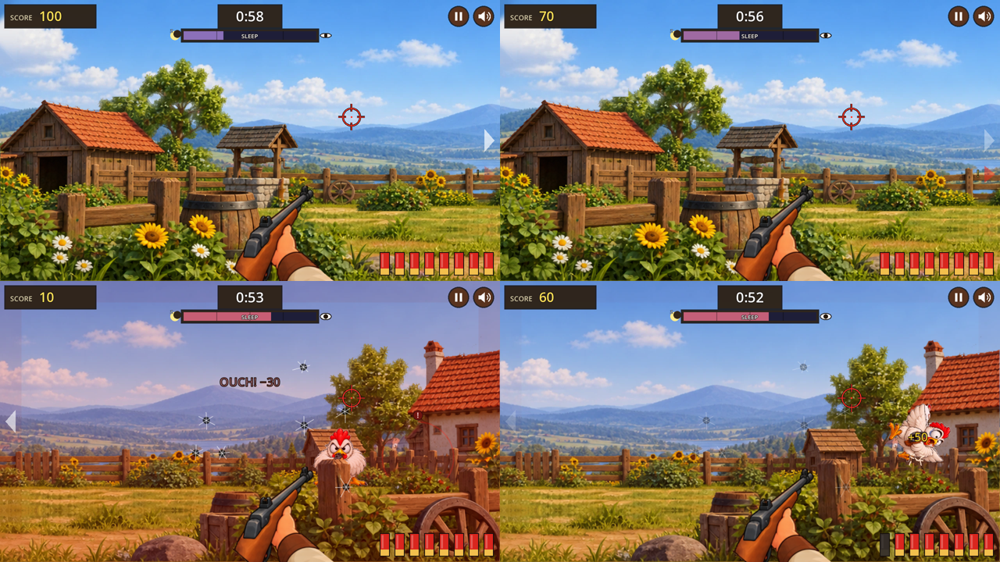

# Chicken Shooter

Тир в духе Moorhuhn на **Godot 4.3**. Мужик пришёл с ночной смены, а петух не даёт уснуть, так что в ход идёт ружьё.
A Moorhuhn-style shooting gallery made with **Godot 4.3**. A guy comes home from the night shift, the rooster won't let him sleep, so he grabs his shotgun.




## Возможности
- ружьё следует за курсором или пальцем, видны только руки и ствол (вид от первого лица)
- бегущие, летающие и прячущиеся курицы четырёх пород
- бронированные курицы: нужно минимум 3 попадания
- курицы-стрелки из-за бочки и забора, которые палят в ответ
- шкала сна: пропущенные курицы и петух будят героя
- комикс-вступление, меню с выстрелами по дощечкам, отдельная громкость музыки и звуков
- русский и английский язык (определяется автоматически)
- интеграция с SDK Яндекс Игр

## Играть
- **В браузере:** https://toxtron.github.io/chicken-shooter/
  (Settings → Pages → Deploy from a branch → `main` / `/docs`)
- **На Android:** скачайте `chicken-shooter.apk` из раздела [Releases](../../releases) и установите (нужно разрешить установку из неизвестных источников). Только 64-битные телефоны (arm64).

## Запуск из исходников
1. Установите [Godot 4.3](https://godotengine.org/download) (стандартная версия, без .NET).
2. Откройте `project.godot` и нажмите F5.

Управление: мышь или палец — прицел, клик или касание — выстрел.

## Сборка
### Браузер / Яндекс Игры
```bash
godot --headless --export-release "Web" build/web/index.html
cd build/web && zip -r ../../chicken-shooter-yandex.zip .
```
Для GitHub Pages замените содержимое `docs/` файлами из `build/web/`.

### Android
1. В Godot: **Editor → Editor Settings → Export → Android** укажите путь к Android SDK и JDK 17+.
2. В **Project → Export → Android** укажите свой keystore (release), затем **Export Project**.

Ключ подписи (`keys/`) в репозиторий не входит и хранится только у автора.
